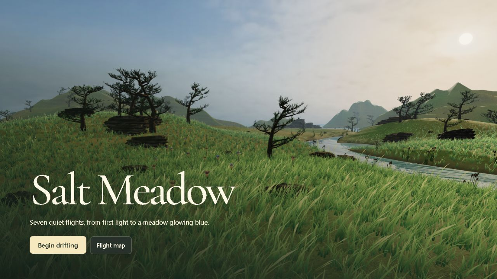

# Meadows
Flower style game, meditate with the wind!

## Salt Meadow

[Play Salt Meadow](https://salt-meadow-drift.benclawbot.chatgpt.site)

Salt Meadow is a meditative 3D flight game set in a tidal meadow. You steer a breeze carrying a single petal. Fly low to brush past buds, or climb for a view of the coast.



### How it plays

Passing a bud opens the flower, adds its colour to your trail, and plays a note that fits the current harmony. Gold flowers sound a harp, warm pinks and whites sound a piano, and lavender and blue add flute. You decide the timing by how you fly.

As each of the three patches comes into bloom, more instruments join the chamber score and the light warms. After the last patch, stay and drift for as long as you like.


### Play

- Desktop mouse. Move away from the centre of the game to steer, and hold the left button for a gust. Arrow keys or WASD also steer. Space adds a gust. Press Esc or P to pause.
- Phone. Open the game over HTTPS, tap **Begin drifting**, and allow motion access if asked. Hold the phone at a comfortable angle to set your neutral position. Tilt to steer and hold a thumb against the meadow for a gust. Tap **Reset tilt** during flight or in **Pause** to set a new neutral angle. You can switch to touch steering in **Pause**.

Steer upward to explore above the meadow. Centre the controls to glide at altitude, then descend to gather blooms near the grass.

### Run the source

Requires Node.js 20+ and a WebGL 2 browser.

```sh
npm ci
npm test
npm run build
npm run preview
```

The build writes a self-contained `dist/index.html`. You can open it directly on desktop or serve it over HTTPS for phone tilt. The local preview listens on loopback.

### Credits

The setting, game, and composition are original to Salt Meadow.

- [Three.js](https://github.com/mrdoob/three.js) is MIT-licensed.
- Upright piano, cello, flute, and harp recordings are from [Versilian Studios VSCO 2 Community Edition](https://github.com/sgossner/VSCO-2-CE/tree/440300901dfe9275fd84e0b7763af1f8443ae62e), released under CC0. Simon Dalzell of Ivy Audio recorded the upright piano.
- [Cormorant Garamond](https://github.com/CatharsisFonts/Cormorant) is by Christian Thalmann and is distributed under the SIL Open Font License in `samples/OFL.txt`.
