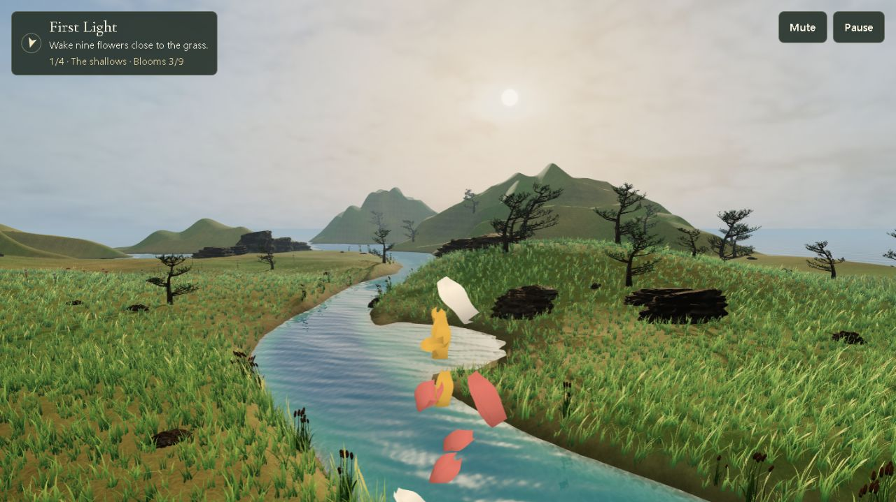

# Meadows
Flower style game, meditate with the wind!

## Salt Meadow

[Play Salt Meadow](https://salt-meadow-drift.benclawbot.chatgpt.site)

Salt Meadow is a meditative 3D flight game set in a tidal meadow. You steer a breeze carrying a single petal. Fly low to brush past buds, or climb for a view of the coast.


### How it plays

Passing a bud opens the flower, lifts colored petals into your trail, and plays a note that fits the current harmony. Gold flowers sound a harp, warm pinks and whites sound a piano, and lavender and blue add flute. You decide the timing by how you fly.

As you make progress through a flight, more instruments join the chamber score and the light warms.

In First Light you can skim the fescue under the pines, follow the creek from pebble shallows into open water, or climb to see the wooded ridges. The water uses a ripple texture baked in Blender and reflects the banks and sky as you fly. The grass bends as you pass. Petals lift from the flowers, fan out through turns, and settle as you glide.



### Flights

1. **First Light** — Wake flowers in the shallows and tidal flats, then follow a long loop back to the coast.
2. **Reedbank Waltz** — Bring three reed beds into song and sweep around ridges between them.
3. **Tideglass** — Follow the channel downstream, bloom the salt bank, and circle back upstream.
4. **A Basket of Color** — Gather specific colors in three glades linked by wide turns.
5. **The Long Exhale** — Climb into the high wind, descend into a sheltered glade, and ride a second rise.
6. **Last Light** — Carry evening light across three glades before flying out along the headland.
7. **Blue After Dark** — Wake glowing blue flowers in three night glades and follow moonlit wind rings.

Each flight has four to six stages with no time limits. Finishing a flight opens the next. Keep drifting after the final stage or open the Flight map to replay any unlocked route. Progress is saved in your browser.

### Play

- Desktop mouse. Move away from the centre of the game to steer, and hold the left button for a gust. Arrow keys or WASD also steer. Space adds a gust. Press Esc or P to pause.
- Phone. Open the game over HTTPS, tap **Begin drifting**, and allow motion access if asked. Hold the phone at a comfortable angle to set your neutral position. Tilt to steer and hold a thumb against the meadow for a gust. Tap **Reset tilt** during flight or in **Pause** to set a new neutral angle. You can switch to touch steering in **Pause**.

Steer upward to explore above the meadow. Centre the controls to glide at altitude, then descend to gather blooms near the grass.

### Run the source

Requires Node.js 20.18.3 or later and a WebGL 2 browser.

```sh
npm ci
npm test
npm run build
npm run preview
```

The build writes a self-contained `dist/index.html`. You can open it directly on desktop or serve it over HTTPS for phone tilt. The local preview listens on loopback.

The editable scene contains the sculpted terrain, vegetation, packed photographs, shallow-water simulation and sky. The browser build uses the exported meshes, height grid, ripple texture, and sky panorama. [First Light Blender scene](art/First-Light.blend)

### Credits

The setting, game, and composition are original to Salt Meadow.

- [Three.js](https://github.com/mrdoob/three.js) is MIT-licensed.
- The sky combines two CC0 panoramas from Poly Haven. [Coastal dusk](https://polyhaven.com/a/qwantani_sunset_puresky), [broken cloud](https://polyhaven.com/a/kloofendal_38d_partly_cloudy_puresky)
- Photographed surface textures come from Poly Haven’s CC0 library. [Turf](https://polyhaven.com/a/leafy_grass), [grass blades](https://polyhaven.com/a/grass_medium_01), [pine bark](https://polyhaven.com/a/bark_brown_02), [sandstone](https://polyhaven.com/a/coast_land_rocks_01), [coastal sand](https://polyhaven.com/a/coast_sand_02), [river pebbles](https://polyhaven.com/a/river_small_rocks), [CC0 license](https://polyhaven.com/license)
- Upright piano, cello, flute, and harp recordings are from [Versilian Studios VSCO 2 Community Edition](https://github.com/sgossner/VSCO-2-CE/tree/440300901dfe9275fd84e0b7763af1f8443ae62e), released under CC0. Simon Dalzell of Ivy Audio recorded the upright piano.
- [Cormorant Garamond](https://github.com/CatharsisFonts/Cormorant) is by Christian Thalmann and is distributed under the SIL Open Font License in `samples/OFL.txt`.
